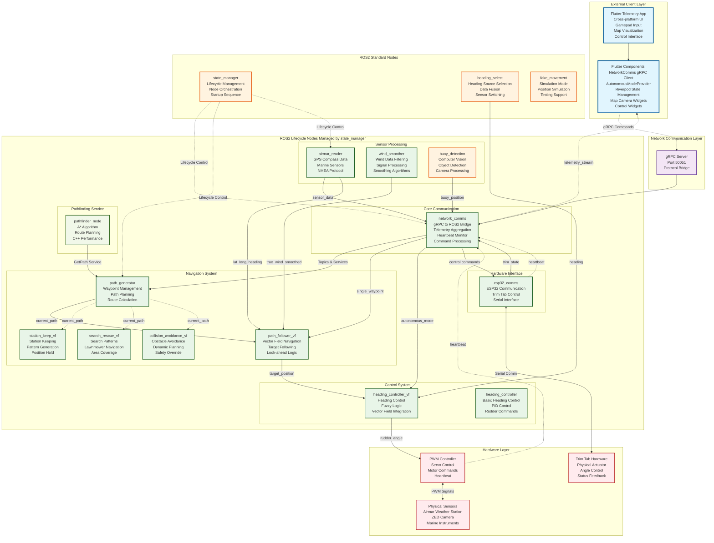

# Complete Node Architecture for Sailbot System

## System-Wide Node Architecture



## Node Classification & Responsibilities

### Flutter Application (External Client)
- **Type**: Standalone Flutter/Dart application
- **Communication**: gRPC client to ROS2 system
- **Key Components**:
  - `NetworkComms` (gRPC client wrapper)
  - `AutonomousModeProvider` (Riverpod state management)
  - UI widgets for control and visualization

### ROS2 Lifecycle Nodes (Managed)
These nodes are managed by `state_manager` with coordinated startup/shutdown:

| Node | Primary Function | Key Topics/Services |
|------|------------------|---------------------|
| **network_comms** | gRPC ↔ ROS2 bridge, telemetry aggregation | `single_waypoint`, `autonomous_mode`, `current_path` |
| **path_generator** | Waypoint management, path planning | `waypoints`, `current_path`, GetPath service |
| **path_follower_vf** | Vector field navigation execution | `current_path`, `target_position` |
| **heading_controller_vf** | Fuzzy logic heading control | `target_position`, `rudder_angle` |
| **airmar_reader** | GPS/compass/weather data processing | `airmar_data/*` topics |
| **wind_smoother** | Wind data filtering and smoothing | `true_wind_smoothed`, `apparent_wind_smoothed` |
| **esp32_comms** | Trim tab hardware communication | `tt_control`, `trim_state` |

### ROS2 Standard Nodes
| Node | Type | Function |
|------|------|----------|
| **state_manager** | Node | Lifecycle orchestration, startup sequence |
| **heading_select** | Node | Heading source selection and fusion |
| **buoy_detection** | Node | Computer vision, object detection |
| **fake_movement** | Node | Simulation mode for testing |

### C++ Pathfinding Service
| Node | Language | Function |
|------|----------|----------|
| **pathfinder_node** | C++ | A* pathfinding algorithm, performance-critical |

## Navigation Mode Architecture

The system supports multiple navigation modes through different node combinations:

### 1. **Waypoint Navigation** (`path_test_vf.py`)
```
path_generator → path_follower_vf → heading_controller_vf → PWM
```

### 2. **Station Keeping** (`station_keep.py`)
```
station_keep_vf → heading_controller_vf → PWM
```

### 3. **Search & Rescue** (`search_rescue.py`)
```
search_rescue_vf → heading_controller_vf → PWM
```

### 4. **Collision Avoidance** (`collision_avoidance.py`)
```
collision_avoidance_vf → heading_controller_vf → PWM
```

## Communication Protocols

### 1. **Flutter ↔ ROS2**: gRPC over TCP (Port 50051)
- Commands: `AddWaypointCommand`, `AutonomousModeCommand`, etc.
- Telemetry: `StreamBoatState`, real-time boat status
- Video: `StreamVideo` for camera feeds

### 2. **ROS2 Internal**: Standard ROS2 Topics/Services
- QoS profiles for reliability
- Lifecycle management for coordinated startup
- Service calls for pathfinding

### 3. **Hardware Interface**: 
- **ESP32**: Serial communication for trim tab
- **Airmar**: NMEA 0183 protocol over serial
- **PWM Controller**: Custom protocol for servo control

## System Startup Sequence

1. **state_manager** starts first
2. **Lifecycle nodes** are activated in dependency order:
   - `airmar_reader`, `wind_smoother` (sensors first)
   - `network_comms` (communication bridge)
   - `path_generator` (planning)
   - `path_follower_vf`, `heading_controller_vf` (control)
   - `esp32_comms` (hardware)
3. **Standard nodes** start independently
4. **Flutter app** connects via gRPC when ROS2 system is ready

This architecture provides a clear separation between the external Flutter client (UI/commands) and the ROS2 node ecosystem (control/navigation), with `network_comms` serving as the critical bridge between the two systems.